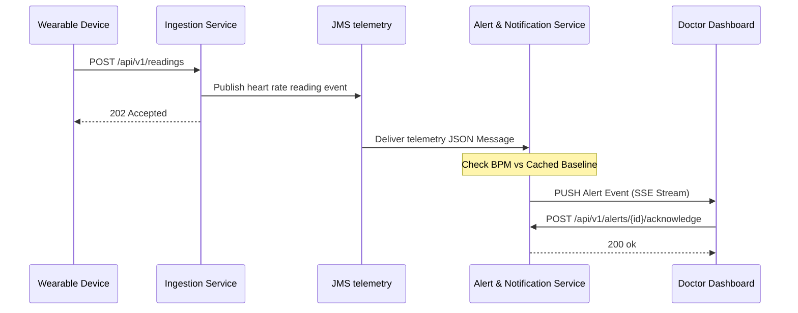
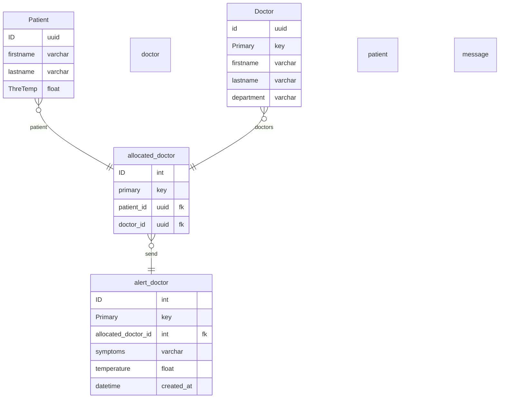

# HEALTH SAFETY

Health safety is an application that sends patient alerts and doctors can assist
them through the system. Keeps track of patient temperature and how track record on the
last message and response.

ONE TIME PIN: WTC-ML5R2WUG

### Database 

